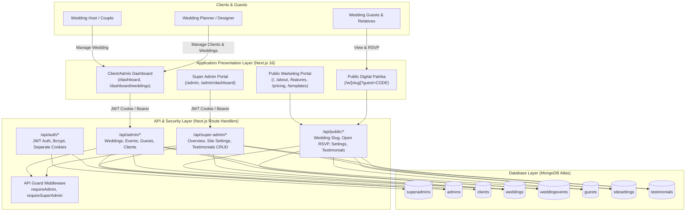
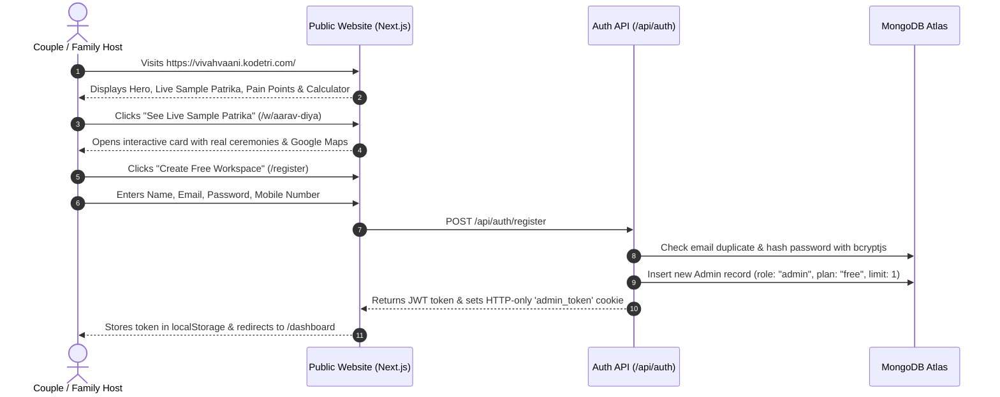
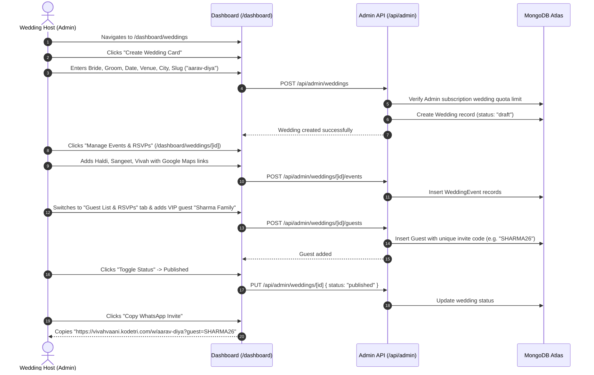
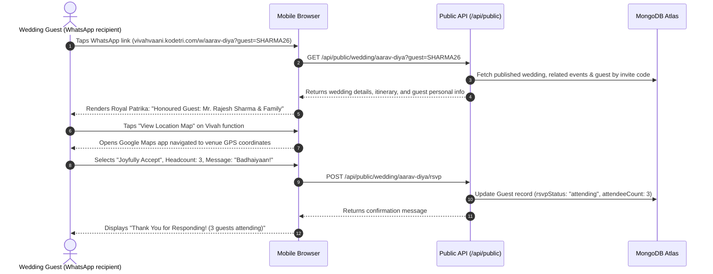
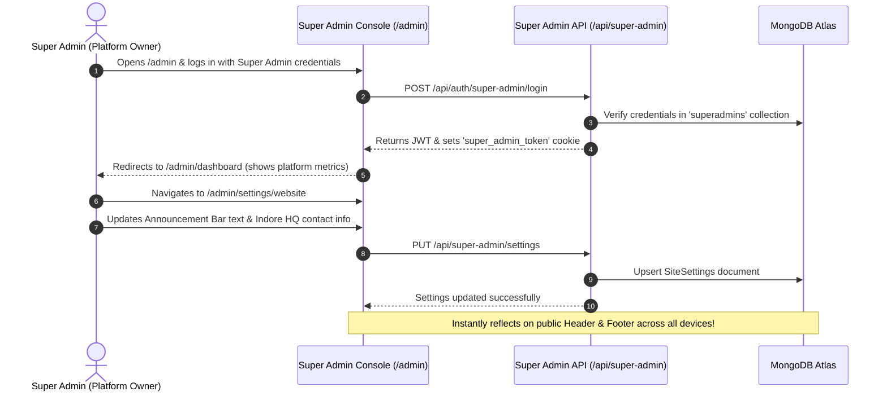

# VivahVaani (Wedding Invitation SaaS) — Project Overview & Product Discovery

> **Document Type:** Product Discovery, Functional Architecture & Executive Overview  
> **Brand Identity:** **VivahVaani** (विवाहवाणी) — *Powered by Kodetri Technologies* (Historically referenced as *VivahVaani* / *Amantran*)  
> **Author / Role:** Senior Software Architect, Product Manager & Technical Documentation Lead  
> **Date:** November 2026  
> **Repository Directory:** `wedding-invitation` | **Workspace Root:** `e:\Amantran`  
> **Technology Foundation:** Next.js 16 (App Router), React 19, TypeScript 5, Tailwind CSS v4, MongoDB, Mongoose 9, JWT & Bcryptjs  

---

## 1. Executive Summary

**VivahVaani** is a specialized, production-ready full-stack Multi-Tenant SaaS platform engineered specifically for the Indian wedding ecosystem. It modernizes the centuries-old cultural tradition of the *Lagan Patrika* (लग्न पत्रिका — auspicious Indian wedding invitation) by transforming physical paper cards and clumsy static WhatsApp PDF files into interactive, regal, mobile-first **Digital Wedding Patrikas**.

The platform is anchored in Indore, Madhya Pradesh (the heart of the Malwa cultural region), designed with cultural reverence, Sanskrit Vedic hymns (*Ganesha Vandana*, *Mangalacharan*), auspicious regional motifs, and regional wedding customs. Simultaneously, it delivers cutting-edge software architecture: sub-second responsive pages, 1-click Google Maps turn-by-turn GPS navigation to wedding venues, interactive RSVP headcount and catering tracking, and 1-click personalized WhatsApp invitation dispatch.

```
       ┌─────────────────────────────────────────────────────────────┐
       │                        VivahVaani                           │
       │    "Har Shaadi Ki Shuruaat, Ek Khoobsurat Nimantran"        │
       └──────────────────────────────┬──────────────────────────────┘
                                      │
            ┌─────────────────────────┼─────────────────────────┐
            ▼                         ▼                         ▼
   ┌──────────────────┐      ┌──────────────────┐      ┌──────────────────┐
   │  Public Portal   │      │ Client Workspace │      │   Super Admin    │
   │  & Guest Patrika │      │  (Agency/Couple) │      │ Platform Console │
   │   (/, /w/[slug]) │      │   (/dashboard)   │      │     (/admin)     │
   └──────────────────┘      └──────────────────┘      └──────────────────┘
```

---

## 2. Problem Statement & Real-World Pain Points

In contemporary Indian weddings, invitations present four major structural, financial, and logistical bottlenecks:

### Problem 1: Excessive Printing Cost & Environmental Paper Waste
- **Traditional Reality:** Printing 300 to 800 physical wedding invitation boxes with gold foil, dry-fruit inserts, and personalized ribbons costs between **₹35,000 and ₹1,50,000**.
- **Logistical Friction:** Courier delays, in-person delivery journeys across cities, and printing press turnaround times of 3 to 4 weeks.
- **Waste Factor:** More than 90% of expensive printed cards are discarded into wastebins within 24 hours of the wedding.

### Problem 2: Confusing WhatsApp PDFs & Cluttered Media
- **Traditional Reality:** Families frequently resort to creating static PDF documents or 20MB video files and blasting them over WhatsApp chats.
- **Friction:** Guests lose the file in cluttered chat histories; elderly relatives struggle to download heavy PDFs; micro-text is illegible without continuous zooming.
- **Lack of Agility:** If a venue lawn changes or a *muhurat* timing shifts by 1 hour due to astrological calculations, re-printing or re-exporting video files creates mass confusion.

### Problem 3: Venue Highway Confusion & "Papa Ji Ko Call" Burden
- **Traditional Reality:** On the wedding day, the fathers and uncles of the bride and groom receive 40 to 80 phone calls asking: *"Bhaiya, bypass se kaunsa turn lena hai? Lawn ka landmark kya hai?"*
- **Friction:** Key family hosts spend their auspicious celebration hours acting as telephone navigators instead of attending ceremonies.

### Problem 4: Catering Headcount Guesswork & Massive Food Wastage
- **Traditional Reality:** 500 guests are invited, but without an RSVP mechanism, caterers cook for 600 plates to be safe.
- **Financial Loss:** At ₹1,200 to ₹2,500 per plate, unconfirmed attendance leads to **₹50,000 to ₹1,50,000 in wasted catering expenses** or stressful food shortages.

---

## 3. VivahVaani’s Core Purpose & Solution

VivahVaani directly solves every one of these problems through a unified web platform:

1. **Sub-15-Minute Digital Delivery:** Create a live royal wedding patrika URL (e.g., `vivahvaani.kodetri.com/w/aarav-diya`) in 15 minutes at a fraction of printing costs (packages starting from ₹299).
2. **Zero App Download / Instant Browser Access:** Guests tap a single WhatsApp link and instantly access the card on any modern iOS or Android mobile browser without registering, entering passwords, or installing apps.
3. **1-Click Turn-by-Turn GPS Navigation:** Every function (Haldi, Mehendi, Sangeet, Shubh Vivah, Reception) embeds verified Google Maps GPS links taking guests straight to the venue's entry gate.
4. **Live RSVP Headcount Tracker:** Guests submit attendance status (Attending / Declined), guest counts (e.g., 3 members), and dietary preferences (e.g., Jain meals) in 2 seconds. The client's dashboard updates in real time with exact plate counts.
5. **Personalized Respect (*Mehmaan Samman*):** Generate unique invite codes where guests see their own family name prominently on the phone screen (e.g., *"Honoured Guest: Mr. Rajesh Sharma & Family"*).

---

## 4. Target User Personas

| Persona | Description | Needs & Motivations | Typical Actions |
|---|---|---|---|
| **Bride, Groom & Families (B2C Hosts)** | Couples or family elders organizing a wedding. | Cost savings, high cultural elegance, peace of mind on wedding day. | Register account, input wedding details, add ceremonies, copy WhatsApp links, track RSVP plates. |
| **Wedding Planners & Studios (B2B Clients)** | Event planners, photographers, invitation designers, and printers. | Client management, offering value-add digital invitations, recurring margin. | Manage multiple client weddings under one workspace, customize itineraries, advise hosts on catering headcount. |
| **Wedding Guests & Relatives (End Users)** | Family relatives, out-of-town guests, elderly friends. | Easy access, clear muhurat schedules, instant GPS directions, quick RSVP without login. | Open WhatsApp link, view itinerary, tap Google Maps button, submit headcount and warm blessings. |
| **Platform Administrator (Super Admin)** | Kodetri Technologies platform operations and governance team. | System visibility, business metrics, customer testimonials, site-wide CMS management. | Monitor platform analytics, manage client accounts, update branding, announcement banner, contact info, and customer reviews. |

---

## 5. Application Architecture & Paradigm

VivahVaani is structured as a **Multi-Tenant Full-Stack Web Application** built on modern Next.js 16 App Router principles:



---

## 6. Main Modules Overview

The codebase is organized into eight functional modules:

### Module 1: Public Marketing & Lead Generation Portal
- **Routes:** `/`, `/about`, `/contact`, `/features`, `/how-it-works`, `/pricing`, `/templates`
- **Purpose:** Educates visitors, displays cultural ethos, showcases template designs, calculates catering cost savings, displays authentic customer testimonials, and converts visitors into registered users.
- **Features:** Dynamic announcement bar, real-time testimonials slider, catering savings slider calculator, template search and filter by cultural tags.

### Module 2: Accountless Public Digital Patrika (`/w/[slug]`)
- **Route:** `/w/[slug]` with optional `?guest=<code>` query parameter.
- **Purpose:** The core product consumed by thousands of wedding guests.
- **Features:**
  - Royal header with Sanskrit shlokas (*Shree Ganeshay Namah*), bride & groom typography, wedding date, venue.
  - Personalized guest greeting badge (*"Honoured Guest: Sharma Family"*).
  - Warm family message (*"A Warm Invitation"*).
  - Multi-ceremony itinerary cards (Haldi, Mehendi, Sangeet, Vivah, Reception) with dates, times, dress codes, and 1-click Google Maps buttons.
  - Interactive RSVP card: Joyful Accept / Regretful Decline, headcount selector, phone number, and blessing wishes textarea.
  - Emergency travel assistance telephone contact buttons.

### Module 3: Client & Vendor Authentication System
- **Routes:** `/login`, `/register`, `/api/auth/login`, `/api/auth/register`, `/api/auth/me`, `/api/auth/logout`
- **Purpose:** Secure tenant onboarding and session maintenance.
- **Mechanism:** Bcryptjs password hashing, JWT token generation (7-day validity), simultaneous `admin_token` and `auth_token` HTTP-only cookie dispatch, and `localStorage` backup token storage.

### Module 4: Client Wedding Management Engine
- **Routes:** `/dashboard`, `/dashboard/weddings`, `/dashboard/weddings/[id]`, `/dashboard/clients`
- **Purpose:** Self-service workspace for couples and wedding planners.
- **Features:**
  - Overview metrics (Total Weddings, Published Weddings, Total Clients).
  - Wedding creation modal (Bride name, Groom name, Date, Venue, City, custom URL slug, package tier).
  - Plan quota check (`activeWeddingLimit` enforced against Admin subscription).
  - Wedding status toggle (Draft / Published).
  - Copy public invitation link.

### Module 5: Ceremony & Multi-Day Itinerary Engine
- **API Routes:** `/api/admin/weddings/[id]/events`, `/api/admin/weddings/[id]/events/[eventId]`
- **Purpose:** Build out multi-event timelines for Indian wedding traditions.
- **Features:** Create, read, update, and delete ceremonies (Haldi, Mehendi, Sangeet, Wedding, Reception, Engagement, Custom) with start/end timings, venue address, Google Maps URL, and dress codes.

### Module 6: Guest List & Live RSVP Tracking Engine
- **API Routes:** `/api/admin/weddings/[id]/guests`, `/api/admin/weddings/[id]/guests/[guestId]`, `/api/public/wedding/[slug]/rsvp`
- **Purpose:** Guest registry management and real-time catering analytics.
- **Features:**
  - Add VIP guest with headcount and contact details.
  - Generate unique 8-character hex invite code (`crypto.randomBytes(4).toString("hex").toUpperCase()`).
  - Pre-formatted WhatsApp invitation copy button.
  - Real-time RSVP calculation: Total Invited, Confirmed Attending, Expected Headcount, Pending, Declined.
  - Open public RSVP handling (when enabled in wedding settings).

### Module 7: Super Admin Platform Console
- **Routes:** `/admin`, `/admin/dashboard`, `/admin/clients`, `/admin/weddings`, `/admin/settings/website`, `/admin/testimonials`
- **Purpose:** Platform governance, site-wide configuration, and business analytics.
- **Security:** Completely isolated authentication stored in the `superadmins` collection, protected by `requireSuperAdmin` guard and `super_admin_token` cookie.
- **Features:**
  - High-level platform metrics (total clients, weddings, guests, end clients).
  - Client search and subscription plan filtering.
  - Global wedding inventory overview with direct links.
  - Full Website Settings CMS (site title, tagline, transparent logo presets, Indore HQ contact info, announcement banner toggle, social links, footer copyright).
  - Testimonial management (full CRUD with star ratings, city badges, active toggles, and display ordering).

### Module 8: Multi-Client Vendor Directory
- **Route:** `/dashboard/clients`
- **API Routes:** `/api/admin/clients`, `/api/admin/clients/[id]`
- **Purpose:** Enables agencies and planners to manage distinct customer families (e.g., Sharma Family, Verma Family) and link specific wedding projects to them.

---

## 7. Business Logic & Tenancy Hierarchy

The business model and data hierarchy follow a strict relational structure inside MongoDB:

```
                  ┌────────────────────────┐
                  │       SuperAdmin       │  (Platform Owner)
                  └────────────────────────┘
                              │ manages platform
                              ▼
                  ┌────────────────────────┐
                  │         Admin          │  (Planner / Agency / Couple)
                  │  Subscription Plan:    │
                  │  free | starter |      │
                  │  professional | agency │
                  └───────────┬────────────┘
                              │
            ┌─────────────────┴─────────────────┐
            ▼                                   ▼
┌────────────────────────┐         ┌────────────────────────┐
│         Client         │         │        Wedding         │
│  (Customer Family)     │◄────────┤  (slug: aarav-diya)    │
└────────────────────────┘         └───────────┬────────────┘
                                               │
                         ┌─────────────────────┴─────────────────────┐
                         ▼                                           ▼
             ┌────────────────────────┐                  ┌────────────────────────┐
             │      WeddingEvent      │                  │         Guest          │
             │ (Haldi, Sangeet, Vivah)│                  │(inviteCode: A1B2C3D4)  │
             └────────────────────────┘                  │(rsvpStatus: attending) │
                                                         └────────────────────────┘
```

### Key Business Rules:
1. **Multi-Tenant Data Isolation:** Every query on `Client`, `Wedding`, `WeddingEvent`, and `Guest` enforces `adminId: auth.userId`. Admins can never inspect or modify another admin's data.
2. **Quota Enforcement:** When creating a wedding, the system counts existing non-archived weddings for that admin. If `activeWeddingCount >= admin.subscription.activeWeddingLimit`, the creation is rejected with a `403 Forbidden` response prompting a subscription upgrade.
3. **Collision-Proof Slugs:** Slugs are sanitized and checked for uniqueness. If `aarav-diya` already exists in MongoDB, the system automatically appends `-1`, `-2`, etc.
4. **Soft Deletion:** Archiving a wedding updates `status = "archived"`, removing it from active lists without breaking historical guest database foreign keys.
5. **Dual RSVP Modes:**
   - **Personalized Mode:** Guest visits `/w/slug?guest=CODE`. The card recognizes their name, loads existing status, and updates that guest record.
   - **Open Public Mode:** Guest visits `/w/slug` without a code. If `wedding.settings.allowPublicRsvp` is enabled, a new guest record is automatically created with an auto-generated invite code.

---

## 8. Complete Technology Stack

| Layer | Technology | Version | Purpose & Architecture Role |
|---|---|---|---|
| **Framework** | Next.js (App Router) | `16.4.6` | Server-side rendering, React Server Components, API Route Handlers, Turbopack bundling |
| **UI Library** | React | `19.3.0` | Declarative UI, Client Components, modern hooks (`use()`, `usePathname`, `useSearchParams`, `Suspense`) |
| **Language** | TypeScript | `^5.0.0` | End-to-end static typing across models, API responses, and frontend state |
| **Styling** | Tailwind CSS | `4.3.3` | Utility-first styling via `@tailwindcss/turbopack`, custom theme variables, animations |
| **Database** | MongoDB | Atlas / v7+ | NoSQL document database storing multi-tenant collections |
| **ODM** | Mongoose | `^9.12.1` | Schemas, validations, virtuals, compound indexes, model caching |
| **Authentication** | JSON Web Tokens (`jsonwebtoken`) | `^9.0.3` | Stateless signed auth tokens with dual-role payload (`admin` vs `super_admin`) |
| **Cryptography** | `bcryptjs` | `^3.0.3` | Salted password hashing (salt rounds: 10) |
| **Icons** | `lucide-react` | `^1.73.0` | Vector iconography for dashboards and UI sections |
| **Typography** | `next/font/google` | Built-in | Variable web fonts: *Plus Jakarta Sans*, *Cormorant Garamond*, *Cinzel*, *Rozha One*, *Noto Serif Devanagari* |
| **Linter** | ESLint | `^9.0.0` | Code quality and Next.js recommended practices check |

---

## 9. Comprehensive User Journeys

### Journey 1: New Visitor Discovery & Self-Service Registration


### Journey 2: Wedding Creation, Itinerary Setup & Guest Link Distribution


### Journey 3: Wedding Guest Opening Patrika & Submitting RSVP


### Journey 4: Super Admin Governance & Live Settings Update

