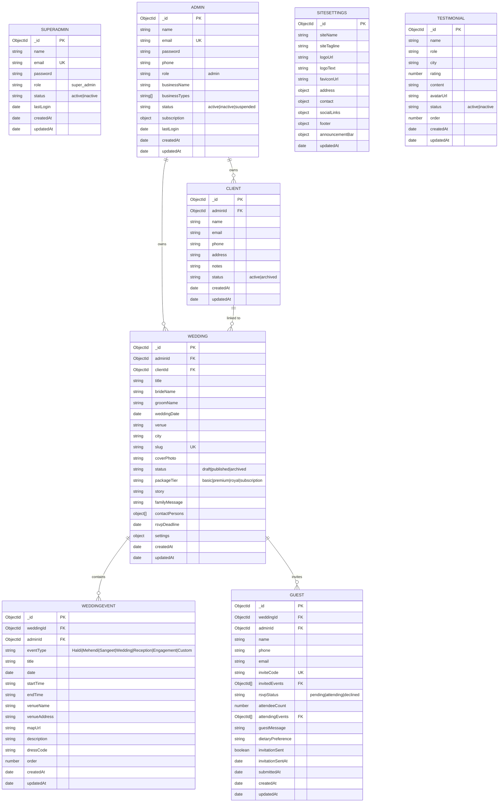

# VivahVaani — Technical Documentation & System Architecture

> **Document Type:** Deep Technical Architecture, Database Schemas, API Reference & Developer Guide  
> **Target Audience:** Senior Architects, Full-Stack Engineers, DevOps & Security Reviewers  
> **Workspace Root:** `e:\Amantran` | **App Root:** `wedding-invitation`  

---

## 1. System Architecture Overview

VivahVaani is architected as a modern **Next.js 16 App Router** full-stack serverless web application. It uses a decoupled layered design separating Presentation, API Route Handlers, Business Guards, and Data Models.

```
       +--------------------------------------------------------+
       |             Client Layer (Browser / Mobile)            |
       |  - Public Portal (React 19 Server & Client Components)  |
       |  - Client Workspace Dashboard (/dashboard)             |
       |  - Super Admin Console (/admin)                        |
       |  - Accountless Digital Patrika (/w/[slug])             |
       +---------------------------+----------------------------+
                                   | HTTP / JSON / Cookies
                                   v
       +--------------------------------------------------------+
       |             Next.js 16 Route Handlers Layer            |
       |  - /api/auth/*         : Auth & Token Management       |
       |  - /api/admin/*        : Tenant Scoped CRUD            |
       |  - /api/public/*       : Open & Personalized Endpoints |
       |  - /api/super-admin/*  : Platform Wide Governance      |
       +---------------------------+----------------------------+
                                   |
         +-------------------------+-------------------------+
         |                                                   |
         v                                                   v
+------------------+                               +------------------+
|   lib/auth.ts    |                               | lib/dbConnect.ts |
| - JWT Sign/Verify|                               | - Mongoose Cache |
| - Bcrypt Salting |                               | - Connection     |
| - Cookie Read/Set|                               |   Pooling        |
+--------+---------+                               +--------+---------+
         |                                                  |
         v                                                  v
+------------------+                               +------------------+
| lib/api-guard.ts |                               |     Mongoose     |
| - requireAdmin   |                               |      Models      |
| - requireSuper   |                               | - Admin          |
+------------------+                               | - SuperAdmin     |
                                                   | - Client         |
                                                   | - Wedding        |
                                                   | - WeddingEvent   |
                                                   | - Guest          |
                                                   | - SiteSettings   |
                                                   | - Testimonial    |
                                                   +--------+---------+
                                                            |
                                                            v
                                                   +------------------+
                                                   |  MongoDB Atlas   |
                                                   | Replica Cluster  |
                                                   +------------------+
```

---

## 2. Directory Tree & Codebase Map

```
e:\Amantran\wedding-invitation\
├── app/
│   ├── favicon.ico                         # Favicon icon
│   ├── globals.css                         # Tailwind CSS v4 directives, custom themes & royal keyframe animations
│   ├── icon.png                            # PWA app icon
│   ├── layout.tsx                          # Root layout, Google Fonts (Devanagari, Rozha, Cinzel, Cormorant, Jakarta)
│   ├── page.tsx                            # Public landing page with interactive mobile preview & testimonials slider
│   ├── about/
│   │   └── page.tsx                        # Public About Us, Indore story & cultural pillars
│   ├── contact/
│   │   └── page.tsx                        # Public Contact & Concierge page (UI form)
│   ├── features/
│   │   └── page.tsx                        # Features breakdown & interactive catering food waste calculator
│   ├── how-it-works/
│   │   └── page.tsx                        # 4-step creation guide & guest experience walkthrough
│   ├── pricing/
│   │   └── page.tsx                        # Pricing packages (₹299, ₹599, ₹999) & cultural FAQs
│   ├── templates/
│   │   └── page.tsx                        # Template gallery with category filters & search
│   ├── login/
│   │   └── page.tsx                        # Client / Planner sign-in page
│   ├── register/
│   │   └── page.tsx                        # Client registration page
│   ├── w/
│   │   └── [slug]/
│   │       └── page.tsx                    # Accountless public digital wedding patrika & RSVP submission
│   ├── dashboard/
│   │   ├── layout.tsx                      # Client workspace shell, auth verification & navigation
│   │   ├── page.tsx                        # Client metrics overview & wedding cards list
│   │   ├── clients/
│   │   │   └── page.tsx                    # Agency end-client directory & client creation
│   │   └── weddings/
│   │       ├── page.tsx                    # Weddings directory, package tiers & wedding creation modal
│   │       └── [id]/
│   │           └── page.tsx                # Single wedding workspace, itinerary events, guests & live RSVP tracker
│   ├── admin/
│   │   ├── page.tsx                        # Super Admin login portal with demo credential helper
│   │   └── (dashboard)/
│   │       ├── layout.tsx                  # Super Admin shell, sidebar navigation & session guard
│   │       ├── dashboard/
│   │       │   └── page.tsx                # Super Admin platform-wide metrics & recent activity
│   │       ├── clients/
│   │       │   └── page.tsx                # Super Admin client directory with plan filters
│   │       ├── weddings/
│   │       │   └── page.tsx                # Super Admin global wedding inventory
│   │       ├── settings/
│   │       │   └── website/
│   │       │       └── page.tsx            # Super Admin website CMS (branding, announcement, contact, footer)
│   │       └── testimonials/
│   │           └── page.tsx                # Super Admin customer reviews CRUD manager
│   └── api/
│       ├── health/
│       │   └── route.ts                    # System and database health check endpoint
│       ├── auth/
│       │   ├── login/route.ts              # Forwarder to admin login
│       │   ├── logout/route.ts             # Forwarder to admin logout
│       │   ├── me/route.ts                 # Forwarder to admin session check
│       │   ├── register/route.ts           # Forwarder to admin register
│       │   ├── admin/
│       │   │   ├── login/route.ts          # Authenticate Admin, set cookies & return JWT
│       │   │   ├── logout/route.ts         # Clear Admin tokens & cookies
│       │   │   ├── me/route.ts             # Validate Admin JWT & return user profile
│       │   │   └── register/route.ts       # Register new Admin account
│       │   └── super-admin/
│       │       ├── login/route.ts          # Authenticate Super Admin in 'superadmins' collection
│       │       ├── logout/route.ts         # Clear Super Admin session cookie
│       │       └── me/route.ts             # Validate Super Admin session
│       ├── admin/
│       │   ├── clients/
│       │   │   ├── route.ts                # List & create clients for logged-in Admin
│       │   │   └── [id]/route.ts           # Get, update & archive client
│       │   └── weddings/
│       │       ├── route.ts                # List & create weddings with quota verification
│       │       └── [id]/
│       │           ├── route.ts            # Single wedding detail, RSVP stats, edit & soft-delete
│       │           ├── events/
│       │           │   ├── route.ts        # List & create wedding ceremonies/events
│       │           │   └── [eventId]/route.ts # Update & delete wedding ceremony
│       │           └── guests/
│       │               ├── route.ts        # List & create guests with unique inviteCode
│       │               └── [guestId]/route.ts # Update guest status & delete guest
│       ├── public/
│       │   ├── settings/route.ts           # Fetch public site settings (branding, announcement bar)
│       │   ├── testimonials/route.ts       # Fetch active testimonials for landing slider
│       │   └── wedding/
│       │       └── [slug]/
│       │           ├── route.ts            # Public wedding card & personalized guest info
│       │           └── rsvp/route.ts       # Public RSVP submission (personalized or open)
│       └── super-admin/
│           ├── overview/route.ts           # Platform counts and recent 50 records
│           ├── settings/route.ts           # GET & PUT site settings CMS
│           └── testimonials/
│               ├── route.ts                # List all & create testimonial
│               └── [id]/route.ts           # Update & delete testimonial
├── components/
│   └── public/
│       ├── Header.tsx                      # Public header with dynamic announcement bar & logo
│       └── Footer.tsx                      # Public footer with dynamic contact, address & links
├── lib/
│   ├── api-guard.ts                        # Route guards: requireAdmin, requireSuperAdmin
│   ├── auth.ts                             # JWT signing/verification, bcrypt hashing, cookie extractors
│   └── dbConnect.ts                        # Mongoose connection pooling & caching
├── models/
│   ├── Admin.ts                            # Admin/Client user schema with subscription quota
│   ├── Client.ts                           # End-client schema linked to Admin
│   ├── Guest.ts                            # Wedding guest schema with inviteCode & RSVP state
│   ├── SiteSettings.ts                     # Platform-wide branding, contact & banner schema
│   ├── SuperAdmin.ts                       # Dedicated super administrator schema
│   ├── Testimonial.ts                      # Customer review schema with ratings & status
│   ├── Wedding.ts                          # Wedding project schema with slug & settings
│   └── WeddingEvent.ts                     # Multi-ceremony itinerary event schema
├── public/                                 # Static assets (transparent logos, icons, whatsapp badge)
├── scripts/                                # Seed and test scripts (reseed-clean-db, test-e2e, test-auth)
├── next.config.ts                          # Next.js config with Turbopack CSS loaders
├── package.json                            # Dependencies & npm scripts
└── tsconfig.json                           # TypeScript compiler configuration
```

---

## 3. Database Architecture & Schema Reference

The data layer uses MongoDB via Mongoose. Every model is defined with explicit types, strict validation, and compound indexes.



### Detailed Collection Breakdown

#### 1. `admins` (Collection: `admins`)
- **Primary Key:** `_id` (`ObjectId`)
- **Key Fields:**
  - `email` (String, unique, lowercase, trimmed, indexed).
  - `password` (String, bcrypt hash).
  - `name` (String, required).
  - `phone` (String, optional).
  - `role` (Enum: `"admin"`, default: `"admin"`).
  - `businessName` (String, optional).
  - `businessTypes` (Array of Strings: `invitation_designer`, `wedding_planner`, `photographer`, `videographer`, `decorator`, `caterer`, `makeup_artist`, `venue_manager`, `other`).
  - `status` (Enum: `"active"`, `"inactive"`, `"suspended"`, default: `"active"`, indexed).
  - `subscription`:
    - `plan` (Enum: `"free"`, `"starter"`, `"professional"`, `"agency"`, default: `"free"`).
    - `status` (Enum: `"none"`, `"active"`, `"past_due"`, `"cancelled"`, default: `"none"`).
    - `expiresAt` (Date, optional).
    - `activeWeddingLimit` (Number, default: `1`).
  - `lastLogin` (Date).

#### 2. `superadmins` (Collection: `superadmins`)
- **Primary Key:** `_id` (`ObjectId`)
- **Isolation:** Stored in a distinct, separate collection to prevent role-injection attacks.
- **Key Fields:**
  - `email` (String, unique, lowercase, trimmed, indexed).
  - `password` (String, bcrypt hash).
  - `name` (String, required).
  - `role` (Enum: `"super_admin"`, default: `"super_admin"`).
  - `status` (Enum: `"active"`, `"inactive"`, default: `"active"`, indexed).
  - `lastLogin` (Date).

#### 3. `clients` (Collection: `clients`)
- **Primary Key:** `_id` (`ObjectId`)
- **Foreign Key:** `adminId` -> `Admin._id` (indexed).
- **Compound Index:** `{ adminId: 1, status: 1 }`.
- **Key Fields:** `name` (String, required), `email`, `phone`, `address`, `notes`, `status` (`"active"` | `"archived"`).

#### 4. `weddings` (Collection: `weddings`)
- **Primary Key:** `_id` (`ObjectId`)
- **Foreign Keys:**
  - `adminId` -> `Admin._id` (required, indexed).
  - `clientId` -> `Client._id` (optional, indexed).
- **Compound Indexes:**
  - `{ adminId: 1, status: 1 }`
  - `{ slug: 1, status: 1 }`
- **Key Fields:**
  - `slug` (String, unique, lowercase, trimmed, indexed).
  - `title`, `brideName`, `groomName` (Strings, required).
  - `weddingDate` (Date, required, indexed).
  - `venue`, `city` (Strings).
  - `coverPhoto` (String, URL).
  - `status` (Enum: `"draft"`, `"published"`, `"archived"`, default: `"draft"`, indexed).
  - `packageTier` (Enum: `"basic"`, `"premium"`, `"royal"`, `"subscription"`, default: `"basic"`).
  - `story`, `familyMessage` (Strings, optional).
  - `contactPersons`: Array of `{ name, phone, relation }`.
  - `settings`:
    - `allowPublicRsvp` (Boolean, default: `true`).
    - `showHeadcount` (Boolean, default: `true`).
    - `notifyOnRsvp` (Boolean, default: `true`).

#### 5. `weddingevents` (Collection: `weddingevents`)
- **Primary Key:** `_id` (`ObjectId`)
- **Foreign Keys:**
  - `weddingId` -> `Wedding._id` (required, indexed).
  - `adminId` -> `Admin._id` (required, indexed).
- **Compound Index:** `{ weddingId: 1, order: 1 }`.
- **Key Fields:**
  - `eventType` (Enum: `"Haldi"`, `"Mehendi"`, `"Sangeet"`, `"Wedding"`, `"Reception"`, `"Engagement"`, `"Custom"`, default: `"Custom"`).
  - `title` (String, required).
  - `date` (Date, required, indexed).
  - `startTime` (String, required), `endTime` (String, optional).
  - `venueName` (String, required), `venueAddress` (String).
  - `mapUrl` (String, Google Maps link).
  - `dressCode` (String, optional).
  - `order` (Number, default: `0`).

#### 6. `guests` (Collection: `guests`)
- **Primary Key:** `_id` (`ObjectId`)
- **Foreign Keys:**
  - `weddingId` -> `Wedding._id` (required, indexed).
  - `adminId` -> `Admin._id` (required, indexed).
- **Compound Indexes:**
  - `{ weddingId: 1, inviteCode: 1 }` (Unique).
  - `{ weddingId: 1, rsvpStatus: 1 }`.
- **Key Fields:**
  - `name` (String, required).
  - `phone`, `email` (Strings, optional).
  - `inviteCode` (String, required, indexed).
  - `invitedEvents` (Array of `ObjectId` refs to `WeddingEvent`).
  - `rsvpStatus` (Enum: `"pending"`, `"attending"`, `"declined"`, default: `"pending"`, indexed).
  - `attendeeCount` (Number, default: `1`, min: `0`).
  - `attendingEvents` (Array of `ObjectId` refs to `WeddingEvent`).
  - `guestMessage` (String, optional blessing message).
  - `dietaryPreference` (String, optional).
  - `invitationSent` (Boolean, default: `false`).
  - `invitationSentAt`, `submittedAt` (Dates).

#### 7. `sitesettings` (Collection: `sitesettings`)
- **Singleton Document** managing platform-wide CMS values.
- **Key Fields:** `siteName`, `siteTagline`, `logoUrl`, `logoText`, `faviconUrl`, `address` (`formattedAddress`, `city`, `state`, `pincode`, `country`), `contact` (`email`, `phone`, `whatsapp`, `workingHours`), `socialLinks`, `footer` (`copyrightText`, `tagline`), `announcementBar` (`enabled`, `text`).

#### 8. `testimonials` (Collection: `testimonials`)
- **Primary Key:** `_id` (`ObjectId`)
- **Key Fields:** `name` (String, required), `role` (default: `"Happy Couple"`), `city` (default: `"Indore, MP"`), `rating` (Number, min: `1`, max: `5`, default: `5`), `content` (String, required), `avatarUrl` (String), `status` (Enum: `"active"`, `"inactive"`, default: `"active"`, indexed), `order` (Number, default: `0`).

---

## 4. Authentication, Security & Tenant Isolation

### Dual-Token Architecture
VivahVaani maintains a strict partition between two types of authenticated users:

```
               [Incoming Request to Route Handler]
                                │
               ┌────────────────┴────────────────┐
               ▼                                 ▼
       Check Bearer Token              Check Request Cookies
      (Authorization Header)          - admin_token
                                      - auth_token
                                      - super_admin_token
                                │
                                ▼
                       jwt.verify(token, SECRET)
                                │
               ┌────────────────┴────────────────┐
               ▼                                 ▼
       role === "admin"               role === "super_admin"
     getAuthAdmin(req)              getAuthSuperAdmin(req)
               │                                 │
               ▼                                 ▼
      requireAdmin guard              requireSuperAdmin guard
```

1. **Client / Vendor Token:**
   - Payload: `{ userId, email, role: "admin", name }`
   - Cookies Set: `admin_token` and `auth_token` (HTTP-only, Lax, 7 days).
   - Extractor: `getAuthAdmin(req)` in `lib/auth.ts`.
   - Route Guard: `requireAdmin(req, handler)` in `lib/api-guard.ts`.
2. **Super Admin Token:**
   - Payload: `{ userId, email, role: "super_admin", name }`
   - Cookie Set: `super_admin_token` (HTTP-only, Lax, 7 days).
   - Extractor: `getAuthSuperAdmin(req)` in `lib/auth.ts`.
   - Route Guard: `requireSuperAdmin(req, handler)` in `lib/api-guard.ts`.

### Strict Tenant Isolation
Every database query in `/api/admin/*` explicitly attaches `adminId: auth.userId`. Even if a malicious user alters an ID parameter in the URL (e.g. `/api/admin/weddings/67890`), MongoDB executes:
```typescript
Wedding.findOne({ _id: id, adminId: auth.userId })
```
If the ID does not belong to that admin, MongoDB returns `null`, and the route responds with a `404 Not Found or Unauthorized`.

---

## 5. Comprehensive API Reference (28 Endpoints)

### A. Health & Diagnostics
| Method | Endpoint | Auth | Description | Response Status |
|---|---|---|---|---|
| `GET` | `/api/health` | None | Database connection status and server health | `200 OK`, `500 Error` |

### B. Authentication Routes
| Method | Endpoint | Auth | Request Body | Description |
|---|---|---|---|---|
| `POST` | `/api/auth/register` | None | `{ name, email, password, phone? }` | Register new client account |
| `POST` | `/api/auth/login` | None | `{ email, password }` | Authenticate client account |
| `GET` | `/api/auth/me` | Admin | Bearer / Cookie | Return current client profile |
| `POST` | `/api/auth/logout` | None | None | Clear client auth cookies |
| `POST` | `/api/auth/admin/register` | None | `{ name, email, password, phone? }` | Underlying admin register |
| `POST` | `/api/auth/admin/login` | None | `{ email, password }` | Underlying admin login |
| `GET` | `/api/auth/admin/me` | Admin | Bearer / Cookie | Underlying admin session check |
| `POST` | `/api/auth/admin/logout` | None | None | Underlying admin logout |
| `POST` | `/api/auth/super-admin/login` | None | `{ email, password }` | Authenticate super admin |
| `GET` | `/api/auth/super-admin/me` | Super Admin | Bearer / Cookie | Return super admin profile |
| `POST` | `/api/auth/super-admin/logout`| None | None | Clear super admin cookie |

### C. Client & Agency Management
| Method | Endpoint | Auth | Request Body / Query | Description |
|---|---|---|---|---|
| `GET` | `/api/admin/clients` | Admin | `?search=&status=` | List clients of logged-in admin |
| `POST` | `/api/admin/clients` | Admin | `{ name, email?, phone?, address?, notes? }` | Create new client record |
| `GET` | `/api/admin/clients/[id]` | Admin | None | Get client details & their weddings |
| `PUT` | `/api/admin/clients/[id]` | Admin | `{ name, email, phone, address, notes, status }` | Update client details |
| `DELETE`| `/api/admin/clients/[id]` | Admin | None | Archive client (soft-delete) |

### D. Wedding Projects & Quotas
| Method | Endpoint | Auth | Request Body / Query | Description |
|---|---|---|---|---|
| `GET` | `/api/admin/weddings` | Admin | `?clientId=&status=` | List all weddings for admin |
| `POST` | `/api/admin/weddings` | Admin | `{ brideName, groomName, weddingDate, venue, city?, slug?, clientId?, packageTier? }` | Create wedding (enforces plan limit) |
| `GET` | `/api/admin/weddings/[id]` | Admin | None | Get wedding details, events & RSVP stats |
| `PUT` | `/api/admin/weddings/[id]` | Admin | Allowed wedding fields | Update wedding details or status |
| `DELETE`| `/api/admin/weddings/[id]` | Admin | None | Archive wedding project (soft-delete) |

### E. Itinerary & Ceremonies
| Method | Endpoint | Auth | Request Body | Description |
|---|---|---|---|---|
| `GET` | `/api/admin/weddings/[id]/events` | Admin | None | List all ceremonies for a wedding |
| `POST` | `/api/admin/weddings/[id]/events` | Admin | `{ eventType, title, date, startTime, endTime?, venueName, venueAddress?, mapUrl?, dressCode?, order? }` | Add ceremony |
| `PUT` | `/api/admin/weddings/[id]/events/[eventId]` | Admin | Updatable event fields | Update ceremony details |
| `DELETE`| `/api/admin/weddings/[id]/events/[eventId]` | Admin | None | Delete ceremony |

### F. Guest Registry & RSVP Analytics
| Method | Endpoint | Auth | Request Body / Query | Description |
|---|---|---|---|---|
| `GET` | `/api/admin/weddings/[id]/guests` | Admin | `?search=&rsvpStatus=` | List guests with RSVP statuses |
| `POST` | `/api/admin/weddings/[id]/guests` | Admin | `{ name, phone?, email?, attendeeCount? }` | Add VIP guest & generate code |
| `PUT` | `/api/admin/weddings/[id]/guests/[guestId]` | Admin | Updatable guest fields | Update guest details or manual RSVP |
| `DELETE`| `/api/admin/weddings/[id]/guests/[guestId]` | Admin | None | Remove guest from registry |

### G. Public Guest Endpoints
| Method | Endpoint | Auth | Request Body / Query | Description |
|---|---|---|---|---|
| `GET` | `/api/public/wedding/[slug]` | None | `?guest=<code>` | Fetch public card & personalized guest name |
| `POST` | `/api/public/wedding/[slug]/rsvp` | None | `{ guestCode?, name?, phone?, rsvpStatus, attendeeCount?, guestMessage? }` | Submit RSVP response |
| `GET` | `/api/public/settings` | None | None | Fetch site settings (branding, banner) |
| `GET` | `/api/public/testimonials` | None | None | Fetch active customer reviews for slider |

### H. Super Admin Governance
| Method | Endpoint | Auth | Request Body | Description |
|---|---|---|---|---|
| `GET` | `/api/super-admin/overview` | Super Admin | None | Platform-wide stats & 50 recent records |
| `GET` | `/api/super-admin/settings` | Super Admin | None | Get full website settings CMS document |
| `PUT` | `/api/super-admin/settings` | Super Admin | Full settings schema | Upsert website settings CMS |
| `GET` | `/api/super-admin/testimonials` | Super Admin | None | List all testimonials (active & inactive) |
| `POST` | `/api/super-admin/testimonials` | Super Admin | `{ name, role, city, rating, content, status, order }` | Create new customer testimonial |
| `PUT` | `/api/super-admin/testimonials/[id]`| Super Admin | Testimonial update fields | Update customer testimonial |
| `DELETE`| `/api/super-admin/testimonials/[id]`| Super Admin | None | Delete customer testimonial |

---

## 6. Environment Variables Reference

The application requires the following environment variables (configured via `.env.local` or host environment):

| Variable Name | Required | Default / Fallback | Purpose |
|---|---|---|---|
| `MONGODB_URI` | Recommended | Built-in fallback string | Direct MongoDB connection URI (e.g. `mongodb+srv://...`) |
| `DB_USERNAME` | Alternative | `""` | Database username when constructing Atlas replica URI |
| `DB_PASS` | Alternative | `""` | Database password when constructing Atlas replica URI |
| `DB_NAME` | Alternative | `"weddinginvitation"` | Target database name in MongoDB |
| `JWT_SECRET` | Critical | `"vivahvaani_jwt_secret_dev_key"` | Secret key used to sign and verify JWT authentication tokens |
| `NODE_ENV` | Optional | `"development"` | Node environment (`development` / `production`) |

---

## 7. Local Development & Setup Instructions

### Prerequisites
- **Node.js:** v18.17.0+ or v20+ recommended
- **npm:** v9+ or v10+
- **MongoDB:** Local instance on `127.0.0.1:27017` OR a MongoDB Atlas cluster URI.

### Step-by-Step Setup
```bash
# 1. Navigate to the project directory
cd e:\Amantran\wedding-invitation

# 2. Configure Environment Variables
# Create a .env.local file in the wedding-invitation directory:
# MONGODB_URI=mongodb://127.0.0.1:27017/weddinginvitation
# JWT_SECRET=<YOUR_STRONG_RANDOM_SECRET>

# 3. Initialize / Seed Sample Database
# Seeds Super Admin, Demo Client Admin, Diya & Aarav wedding, 4 ceremonies & 3 guests
node scripts/reseed-clean-db.mjs

# 4. Start Next.js Development Server
npm run dev

# 5. Open in Browser
# Public Landing Page: http://localhost:3000/
# Public Wedding Sample: http://localhost:3000/w/aarav-diya
# Client Workspace Login: http://localhost:3000/login
# Super Admin Portal: http://localhost:3000/admin
```
